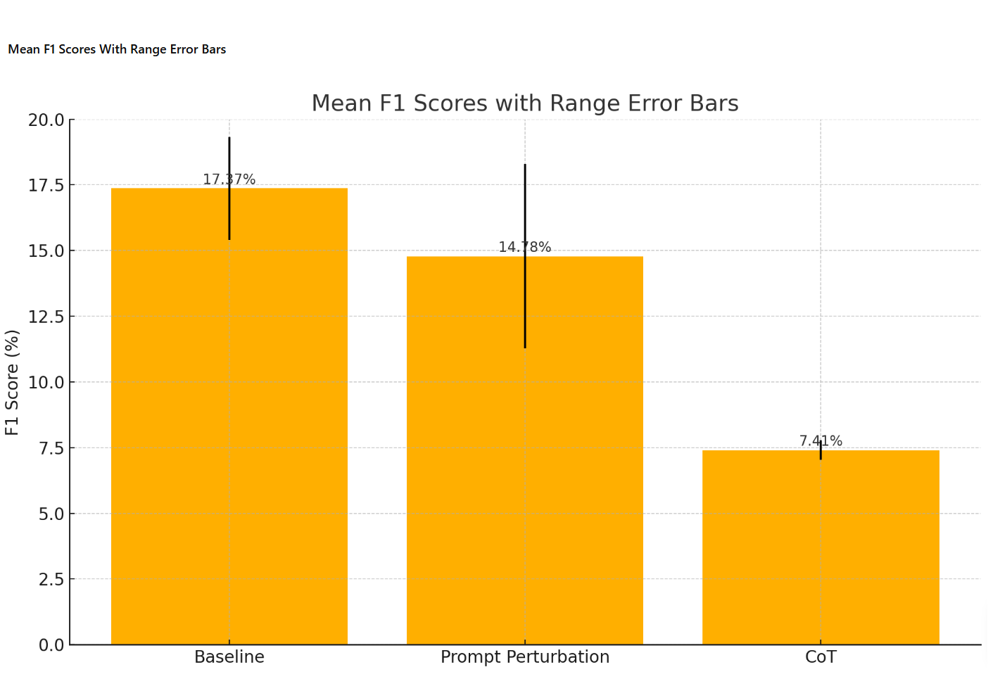

# Adversarial QA Evaluation: Prompt-Perturbation Robustness for Agentic LLMs

## Abstract

Large-language-model (LLM) agents often exhibit brittle behavior under small, semantics-preserving prompt edits. This project evaluates the robustness of **Nova Pro**, an agentic, state-of-the-art LLM, on the **Natural Questions** and **GSM8K** datasets using **PromptBench** perturbations at the character, word, sentence, semantic, and synonym levels.

To address this prompt brittleness, we introduce two resilience strategies:

- **Strategy 1 — StaticCoT Prompting**: applies a fixed chain-of-thought (CoT) template uniformly across all perturbations.
- **Strategy 2 — Gradient-Free Adaptive CoT**: leverages the LLM itself to generate a tailored CoT suffix for each perturbation, with no gradient-based updates.

### Results summary

#### Detailed F1 breakdown by method

| Method | NQ F1 (%) | GSM8K F1 (%) | Mean F1 (%) | Mean F1 (sci) | Range (sci) | Δ F1 (sci) |
|---|---|---|---|---|---|---|
| Baseline | 19.33% | 15.41% | 17.37% | 1.737 × 10⁻¹ | [1.541 × 10⁻¹, 1.933 × 10⁻¹] | 3.920 × 10⁻² |
| Prompt Perturbation | 11.28% | 18.29% | 14.78% | 1.478 × 10⁻¹ | [1.128 × 10⁻¹, 1.829 × 10⁻¹] | 7.010 × 10⁻² |
| CoT | 7.79% | 7.03% | 7.41% | 7.410 × 10⁻² | [7.030 × 10⁻², 7.790 × 10⁻²] | 7.600 × 10⁻³ |


<p align="center">
  
</p>

| Benchmark | Metric | Clean | Perturbed | + Static CoT | + Adaptive CoT (ours) |
|---|---|---|---|---|---|
| Natural Questions (14,018 adversarial prompts) | BERTScore-F1 | baseline | ↓ ~4% | ↓ a further ~5% vs. perturbed | recovers to within ~3% of clean |
| Natural Questions (14,018 adversarial prompts) | F1 | baseline | ↓ ~5% | ↓ a further ~9% vs. perturbed | recovers to within ~5% of clean |
| GSM8K (2,000 adversarial prompts) | Exact Match | 33.3% | 28.9% | 20.9% | **37.8%** (+4.5% over clean) |

Static CoT *compounds* the damage from perturbations; gradient-free adaptive CoT not only recovers the loss but, on GSM8K, surpasses the clean baseline outright.

<details>
<summary><strong>Local trial run</strong> (dev-stage sanity check — not the headline numbers above)</summary>

The snippet below is the actual output of `adversarial-qn-Evaluation.py` + `Chain-of-Thoughts.py` against a 5-example Natural Questions sample, pulled from `CoT-Results.md`. It exercises the StaticCoT path on the one perturbation implemented in this folder so far (a fixed distractor-clause suffix) — it predates the full PromptBench/GSM8K pipeline and is far too small a sample to compare against the paper's results.

```text
Nova Pro Adversarial Evaluation on Natural Questions (first 5 examples):
Exact Match: 0.00%
F1 Score: 10.35%
Average token count per response: 0.00
```

Example from that run:

```text
Original Question: what purpose did seasonal monsoon winds have on trade
Adversarial Question: what purpose did seasonal monsoon winds have on trade
  (consider an alternative perspective that challenges the obvious answer)
Dataset Answer: enabled European empire expansion into the Americas and trade
  routes to become established across the Atlantic and Pacific oceans
Nova Pro Output: Monsoon winds enabled cultural exchange beyond mere trade facilitation.
```

Full log: [`CoT-Results.md`](./CoT-Results.md).
</details>

## Motivation

LLMs are rapidly becoming the backbone of real-world AI agents — powering retrieval-augmented QA, multi-step planning, and dynamic tool invocation. That promise is tempered by a critical vulnerability: even innocuous prompt edits (typos, synonym swaps, appended phrases) can derail an agent's reasoning, suppress necessary tool calls, or trigger hallucinations. Benchmarks like PromptBench and CatAttack show that small, semantics-preserving perturbations can meaningfully degrade otherwise state-of-the-art LLMs.

Robustness to adversarial prompts isn't an academic nicety. In domains like medical diagnosis, financial advising, or autonomous robotics, an agent misled by a single character flip could propagate false information, execute an incorrect action, or fail to invoke a safety check. Fine-tuning on adversarial data or gradient-based defenses require white-box model access and heavy compute that most deployed systems simply don't have.

This project asks: **can black-box LLM agents be hardened against prompt perturbations using lightweight, inference-only interventions?** Chain-of-Thought prompting is a natural candidate — the hypothesis tested here is that appending a CoT suffix (fixed, or adaptively generated per perturbation) can steer the model back onto its intended reasoning path without any parameter updates, offering a scalable, cost-efficient path to resilience within real deployment constraints.

## What's in this folder

This folder holds the exploratory / development-stage scripts behind the project described above — perturbation generation, CoT-suffix strategies, and Natural-Questions evaluation scoring.

| File | Role |
|---|---|
| `baseline-eval.ipynb` | End-to-end baseline notebook: loads Natural Questions (streaming), sets up the Bedrock/Nova Pro client, runs the EM/F1 baseline eval loop. |
| `adversarial-qn-Evaluation.py` | Adversarial eval loop — generates perturbed questions and scores Nova Pro's answers against ground truth. |
| `Chain-of-Thoughts.py` | Adversarial eval loop + CoT explanation — early version of the StaticCoT strategy. |
| `NatQns-Eval.py` | Shared scoring utilities (`compute_exact`, `compute_f1`), adapted from Google's official `nq_eval.py`. |
| `LanguageDS.py` | Scratch script for probing which Hugging Face QA datasets are available/loadable, beyond NQ. |
| `OpenAI-Guided-CoT-Integration.py` | GPT-4-backed CoT-outline generator — one candidate backend for the Adaptive CoT strategy. |
| `Falcon-Guided-CoT-Integration.py` | Falcon-7B-instruct-backed CoT-outline generator — a local/open-weight alternative backend. |
| `Tree-of-Thought.py` | Generic beam-search Tree-of-Thought controller — exploratory reasoning-search framework, not yet wired into the eval loop. |
| `Toolformer.py` | Generic tool-calling agent loop skeleton — exploratory, not yet wired into the eval loop. |
| `Perturbation-Format.txt` | Planned perturbation taxonomy (char-level, sentence-level, semantic). |
| `CoT-Results.md` | Raw console log from an early adversarial-eval run (Natural Questions, 5-example sample). |

## Status

Work on this project ran from **May 2025 to September 2025**. It's being organized and published here now as a showcase of that work. The headline numbers above come from the full PromptBench-driven pipeline (character / word / sentence / semantic / synonym perturbations × GSM8K + Natural Questions × both CoT strategies). The scripts in this folder are earlier iterations and building blocks toward that pipeline — currently only a single static perturbation and the Natural-Questions path are implemented here.

## Setup

```bash
pip install datasets boto3 botocore tqdm transformers torch openai
```

AWS Bedrock credentials (for Nova Pro) are entered interactively via `getpass()` in `baseline-eval.ipynb` — never hardcode them.
